# Recreating Harness²

*Part one of two. We study one implementation of recursive self-improvement by Google called Harness². We investigated its branching decision paths, execution, and tested out its behavior on fresh tasks.*

> **Two dashboards to start with**
>
> [1. Follow the editing process](https://api.wandb.ai/files/wandb/harness2-agent-lens-v4/study-v4-articles-20261026/timeline.html) — See what the agents proposed, tried, combined and finally kept.
>
> [2. Compare results on fresh tasks](https://wandb.ai/wandb/harness2-agent-lens-v4?nw=4o9wknfo8yi) — Inspect outputs and independent grades for the original and frozen harnesses.

## The harness-editing loop


*Animated example: try the coding task → propose a checking script or written rules → try both → fix the script location and combine useful rules → try another edit → keep the earlier version → stop editing and test on new tasks. The agent-written script is not an independent benchmark grade.*

[Open the interactive walkthrough](https://api.wandb.ai/files/wandb/harness2-agent-lens-v4/study-v4-articles-20261026/harness2-agent-lens/assets/process-animation-20261105-plain-language/harness2-process.html) (play/pause, scrub, speed and reduced-motion controls)  ·  [Animated GIF](https://api.wandb.ai/files/wandb/harness2-agent-lens-v4/study-v4-articles-20261026/harness2-agent-lens/assets/process-animation-20261105-plain-language/harness2-process.gif)  ·  [Static overview](https://api.wandb.ai/files/wandb/harness2-agent-lens-v4/study-v4-articles-20261026/harness2-agent-lens/assets/process-animation-20261105-plain-language/harness2-process-poster.png)

When a coding agent makes a mistake, we usually fix it by changing something in the prompt or a Skill.md. This includes things like 'run this test first', or 'don't change these data models', or 'check the diff and summarize before finishing'.

Harness² gives an agent that ability to change the prompt or skill. It proposes changes to the components around a model, tries those changes on a task, and uses the executions from that task to decide what to keep. This gives us a concrete way to examine **recursive self-improvement**, or RSI: the ability for an agent to change how it works, and then uses the consequences of those changes to guide further revisions.

We recreated this process using W&B Inference for model calls, Agent Lens for execution traces, EvalTables for comparisons and W&B artifacts for saved harnesses and patches so we could audit the full end to end process.

## Why harnesses matter for RSI now

The *harness* is the software around the model: instructions, tools, skills, scripts and memory. It shapes how the model approaches a task. A procedure that requires checking an API's existing behavior can steer an agent toward a different patch than a general instruction to fix code. It has to choose what to read, which tools to call, when to test, what to preserve between sessions and when the job is finished.

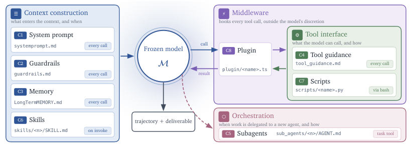

*Paper Figure 2 — The eight editable harness components, grouped by their role in the runtime. Reproduced from Xu et al., Harness² (arXiv:2610.14224v1)*

Harness-level RSI gives an agent a role in that ability to adjust the components of the harness via *editing*. The coding capabilities it uses to edit an application can also edit a script, skill or tool-use rule, which are useful as they can be versioned, tested and rolled back. This gives us the opportunity to retain a correction instead of paying to rediscover the same mistake on every attempt of our agent RSI runs, with the risk being that we retain *the wrong lesson*. These wrong lessons can look like longer instructions that distract our agent, checks the only find surface level assumptions and miss the actual problem it was checking for, and improper workflow saves leading to consistent but implicit errors. This can possibly lead to many rounds of edits, where every round of editing and testing costs inference, making optimizing this RSI process worthwhile.

The Harness² authors report gains large enough to make their method of this worth examining. These selected results use OpenCode, one refinement step, and Claude Opus 4.8 as the editor.

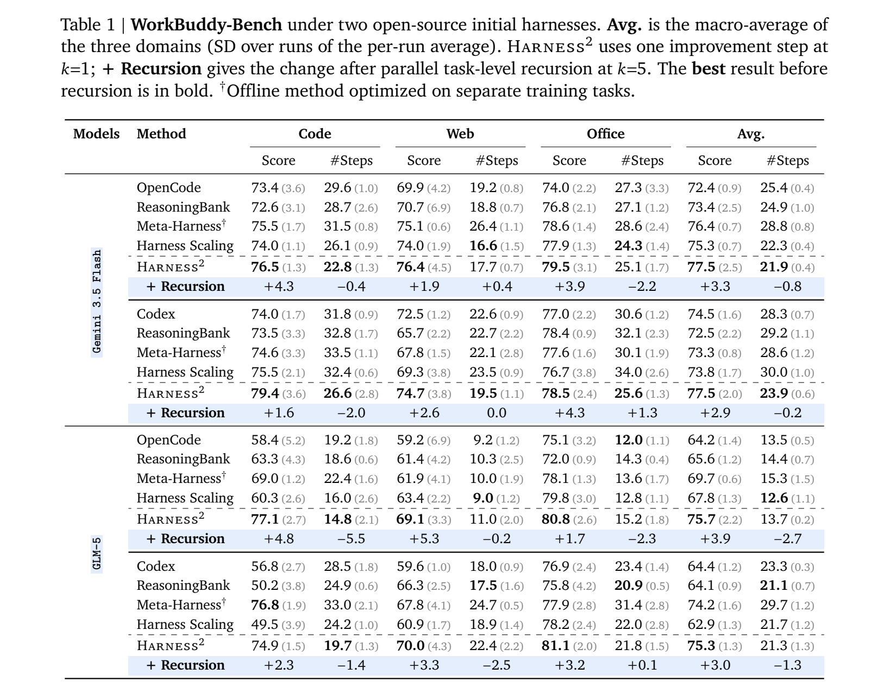

*Paper Table 1 (PDF p. 8) — Original WorkBuddy-Bench results. Harness² rows use one refinement step; “+ Recursion” reports the additional change with parallel recursion at k = 5. The JobBench example in the summary above comes from the paper’s Table 2.*

We wanted to inspect how Harness² approaches these types of edits, then test whether the resulting harness edits help on fresh tasks in as a transfer experiment.

## Following the harness through an edit

What does an editing agent notice in its first execution? How does that impact our change in the harness? Does the next agent actually appropriately utilize what was changed? And does the next edit take all of this into account?

There are two kinds of changes to keep track of here. The agent can fix the repository it is working on (the code), or it can change the instructions and tools it uses to steer its work (the text). In Harness², the solver is the agent doing the coding task, and the editor is the agent changing the solver's harness. The editor reads a solver execution, proposes changes to the instructions and tools, and has the solver try the task again. It can then read that new execution to decide what to change next.

It can also save components and lessons in an experience library for future editors to consult. As our experiment follows the editing process and tests the selected harness on fresh tasks, we did not run a long sequence of tasks to see whether that library gets more useful over time. The editor can change the harness files, but not the model weights or the workflow that schedules proposals, tests and selection.

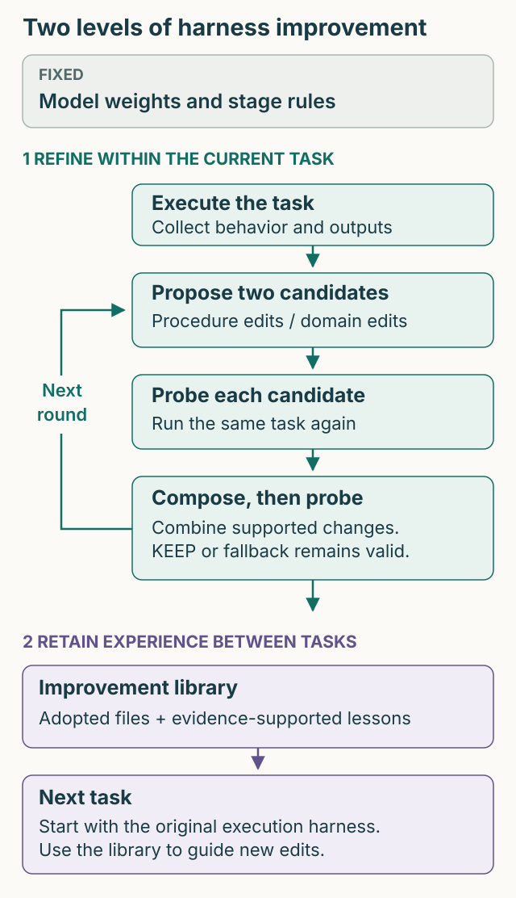

## The agent’s checks had problems of their own

We started with a small coding task from WorkBuddy-Code’s API-contract family. The agent had to add structured errors to a Python library called `pydantic_like`. An error should tell the caller which field caused the problem, what went wrong, the error type and the input that caused it. The change also needed to preserve aliases, defaults and successful validation.

We used `zai-org/GLM-5.3-Flash` through **W&B Inference**, with OpenCode doing both jobs: solving the task and editing the harness.

The first executions showed why checking the agent’s work is not as simple as asking it to run a test. In one, the agent expected “input must be a dict” while its code returned “input must be a mapping.” In another, it wrote this check:

```python
check(str(e) == "boom" and e.message == "message" or True, "compat attrs")
```

The `or True` makes this pass whether or not the compatibility check is right. The agent could report a passing check without testing what it said it was testing.

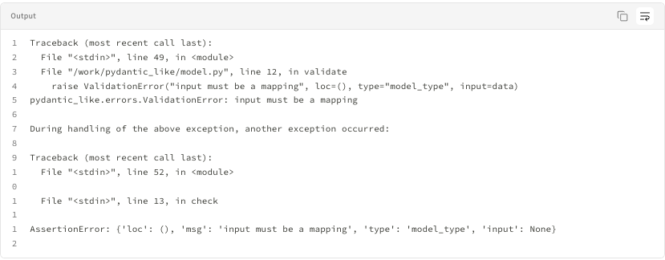

*Agent Lens shows the failed inline assertion, including the expected and actual error message.*

## Trying two ways to improve the checking

Harness² organizes each editing round into three steps: propose harness changes, try them on the task, and combine selected changes into a new harness. It calls this process **Propose–Probe–Compose.**

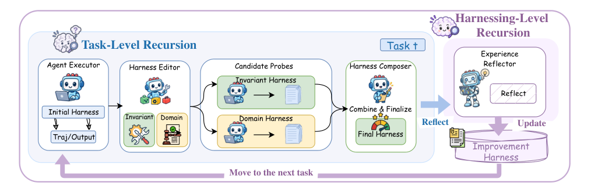

*Paper Figure 3 — The original Harness² pipeline: propose invariant and domain-specific edits, probe candidates, and compose a successor harness. The separate reflection loop updates reusable experience after the task.*

Source: Xu et al., [Harness²: Recursive Agent Harnessing for an Open World — Figure 3](https://arxiv.org/html/2610.14224v1#S2.F3).

One proposal added a contract-checking script to run before and after editing. The other added a skill describing the error contract and compatibility requirements.

Trying these proposals exposed a problem with the new harness itself. The general candidate ran its checker, but also looked for the script under `/work/scripts`, where it was not installed. The editor now had an execution showing both the checking procedure and a mistake in how the solver was told to find it.

In the composition step, the editor kept the checker and changed the command to `python3 ~/harness_scripts/check_contract.py`. It also brought in compatibility rules from the domain proposal. It did not keep that proposal’s separate skill, because its decision said the other files already covered those instructions.

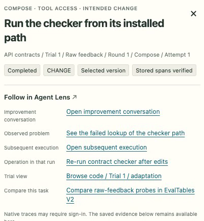

*The composition node explains the checker-path correction and links to the failed lookup, editing conversation and next execution.*

The checker did not mark every difference as a failure. It checked whether the error record contained the requested `loc`, `msg`, `type` and `input` fields. But the task had not specified every value those fields should contain. For a missing required field, for example, the checker printed the error’s `type` value as a REPORT rather than rejecting it for using a particular name. In its default mode, these reports were left for the solver to review; failed checks were marked FAIL. The script therefore separated checks it enforced from choices the task had left open.

[Read the composer’s decision](https://forge.coreweave.com/agent-lens/wandb/harness2-agent-lens-v4/conversations/bfa704aaedec4f89a9cd1b930b4da01e).

## The next solver runs the new checker

The next solver ran with this combined harness. It used the checker on the unmodified code, read the FAIL list, changed `errors.py` and `model.py`, and ran the checker again.

The patch extended the error constructor:

```diff
- def __init__(self, message):
+ def __init__(self, message, loc=(), type="value_error", input=None):
```

The error object stored the new values and included them in the record returned by `errors()`. The patch also updated the two places where validation raises an error: a missing required field and a value of the wrong type. Those errors now included the field location and input value. The code handling alias lookup, defaults and successful validation stayed in its existing paths.

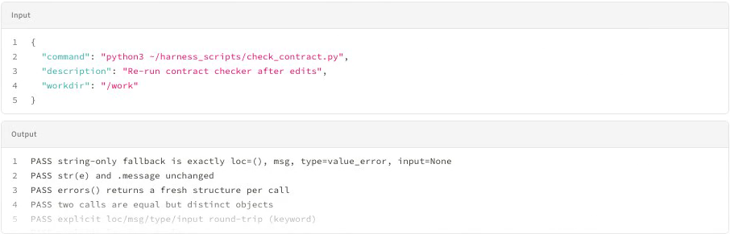

*Agent Lens shows the solver running the installed checker and the checks passing after its patch.*

These are agent-written checks, not independent benchmark grades. Independent grading came later, on fresh tasks. The [selected execution](https://forge.coreweave.com/agent-lens/wandb/harness2-agent-lens-v4/conversations/311f3279da7d4df889284094cbc46301) used the harness later frozen for transfer; its harness diff and delivered repository patch are separate records.

## Choosing an earlier version after another round

We let the editor go through two rounds. In the second, it worked from the first combined harness and the execution that followed it. One proposal addressed blocked attempts to read the checker. Another added checks for list and string error locations. The composer combined them, and another solver tried the task.

After both rounds, the selection step compared the patches produced with the two combined harnesses and chose the **first-round harness**. Its recorded reason favored that patch’s simpler constructor over the later patch’s extra `msg` parameter and helper for converting error locations. It also used a visible task-metadata hint about the expected number of changed lines. That was another reason for its choice, not a test that the patch behaved correctly.

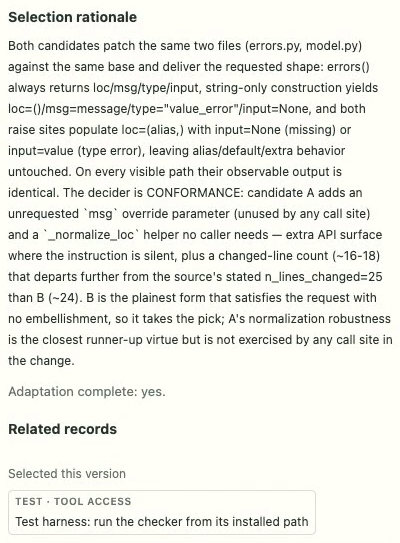

*The selection panel records why the agent chose the first-round version after testing both compositions.*


*Paper Figure 4 — Parallel versus sequential task-level recursion. This diagram explains the paper’s two search patterns; it is not a timeline of our executions. Our walkthrough uses two sequential refinement rounds, with competing proposals inside each round.*

Source: Xu et al., [Harness²: Recursive Agent Harnessing for an Open World — Figure 4](https://arxiv.org/html/2610.14224v1#S2.F4). Reproduced from the paper; not a result of this recreation.

*Native panel: [Explore the API-contract branches · three trials](https://forge.coreweave.com/wandb/wandb/harness2-agent-lens-v4/reports/Recreating-Harness%C2%B2--VmlldzoxODE5OTAxNQ). Open in the report.*

## Reading the branching history

The chart keeps the editing history alongside the runs that tested it. Start with **API contracts → Trial 1 → Both approaches** to follow the example in this article. Blue shows ordinary Harness² with raw feedback; orange adds the diagnostic summaries we discuss in part two. Gray marks the original harness. The colors identify the setups, not which one performed better.

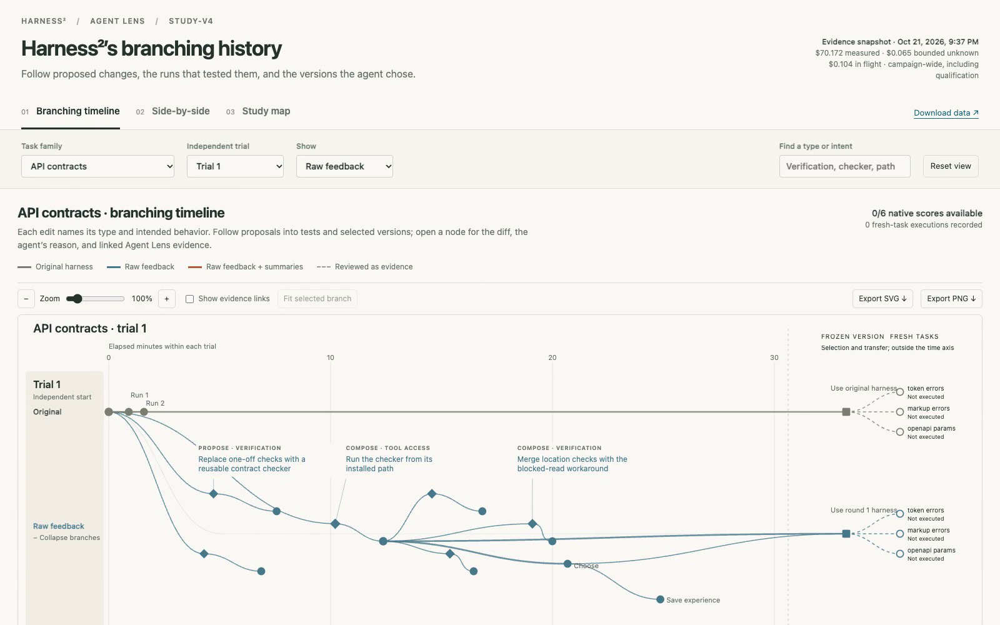

*The custom branching explorer shows API-contract trial one with raw feedback: competing edit-and-test paths lead to a selected frozen version and fresh-task testing.*

The overview shows raw-feedback API-contract trial one. Branches track edits and tests, not score improvements. [Explore the branching history](https://api.wandb.ai/files/wandb/harness2-agent-lens-v4/study-v4-articles-20261026/timeline.html).

### How to follow a branch

Read from left to right. The horizontal axis shows elapsed minutes within that trial; the vertical positions separate the branches so we can follow them. A lower branch is not a lower score.

- **Diamonds mark harness edits.** Read their labels to see what the editor intended to change, then open the node to inspect the saved diff and its reason.
- **Dots mark runs or decisions.** Follow an edit into the run that tested it, rather than assuming that saving a file means the solver used it. Open the linked Agent Lens conversation to inspect the commands and outputs.
- **“No changes” followed by a retest means the same harness ran again.** It is another execution, not another version.
- **Dashed links show evidence the editor reviewed.** Reviewing a proposal does not mean its files were included in the next harness. Check the composition diff to see what was kept.
- **Follow the final selection to the frozen harness.** This is the version kept unchanged for fresh-task testing; it need not be the last version the editor produced.

Use the zoom controls to separate nearby nodes and **Show evidence links** to see what the editor consulted. Switch trials to compare independent adaptations.

Open the [path-correction node](https://api.wandb.ai/files/wandb/harness2-agent-lens-v4/study-v4-articles-20261026/timeline.html#view=timeline&study=code&task=api-contract&trial=1&node=bfa704aaedec4f89a9cd1b930b4da01e) to inspect the editor’s decision, then follow its links to the failed lookup and the next solver execution.

The branching view connects proposals, test executions and selection decisions, including alternatives that were rejected. It lets us follow how the final harness was chosen rather than infer that history from its files.

## Comparing what the harnesses produced

The comparison below places the original harness and both combined versions side by side, with their delivered patches, execution measurements and links to the conversations. These are adaptation executions, not independently graded fresh tasks.

[Open the comparison separately](https://wandb.ai/wandb/harness2-agent-lens-v4?nw=snk3aigmwn9)

*Native panel: [Evaluation Tables](https://forge.coreweave.com/wandb/wandb/harness2-agent-lens-v4/reports/Recreating-Harness%C2%B2--VmlldzoxODE5OTAxNQ). Open in the report.*

### Read the delivered patches

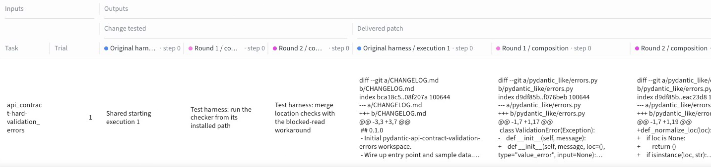

*Native EvalTables V2 aligns trial one's delivered repository patches across harness versions.*

For this trial, the execution measurements looked like this:

| Execution                         | Tool errors | Execution time | Queue wait | Inference cost |
| --------------------------------- | ----------: | -------------: | ---------: | -------------: |
| Original harness, first execution |           2 |        54.21 s |     0.02 s |       $0.01708 |
| First-round composition, selected |           2 |        30.83 s |    95.78 s |       $0.00870 |
| Second-round composition          |           1 |        50.08 s |     0.01 s |       $0.01701 |

The selected version took less execution time and cost less in this trial, but it also waited almost 96 seconds for capacity. The second-round version had fewer tool errors and still was not chosen. These measurements describe the individual executions, not the cost of the whole editing process or the correctness of the patches.

### Execution measurements across three trials

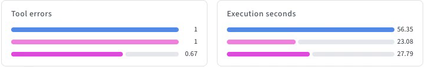

*EvalTables shows aggregate tool-error counts and execution times for the original harness and both compositions across three trials.*

The chart averages all three trials; the table above follows trial one.

## Would the same harness help on fresh tasks?

The checker and instructions were written around `pydantic_like`. That made the example easy to follow, but it also brings us back to the risk in saving a lesson: the next task might need the checking habit without needing the old repository’s paths and assumptions.

To test whether the edits helped on new work, we froze each selected harness: we kept its files unchanged while a solver used it on fresh tasks. We did this in eight coding groups. Each group had an adaptation task and three different held-out tasks. We repeated adaptation from scratch three times in each group, and each resulting harness attempted those three held-out tasks. That gave us **24 distinct tasks and 72 executions per condition**. The original harness attempted the same tasks. When an adaptation failed, we kept its last valid harness, or the baseline if it had not adopted one, so those failures stayed in the comparison.

The full coding study has **216 executions across three conditions**: the original harness, ordinary Harness² with raw feedback, and Harness² with diagnostics. Here we compare the first two. Part two looks at whether the extra diagnostic summaries helped.

The adaptation and held-out tasks came from different repositories. We interleaved the fresh-task executions and graded after they finished. The agents doing the editing could not see the benchmark-added tests or grades, and graders could not see the condition names. Before selecting tasks, we checked their benchmark tests against reference solutions and unchanged code. We then selected from the qualifying tasks using a fixed random seed, rather than choosing tasks based on the model’s scores. Some repositories are partial or reconstructed, so this is still a smaller setting than a full production codebase.

To compare results, we average the three trials for each task and then give every task equal weight. We fixed the analysis before seeing the scores. It uses a paired hierarchical bootstrap to estimate uncertainty while accounting for results that share a harness. We report a 95% interval for the score difference. We also chose a ±5-percentage-point band in advance: to call the approaches practically equivalent under this rule, the entire interval would need to fit inside that band. Repeating tasks across harnesses gives us more measurements, not 216 different coding problems.

The [predeclared protocol](https://github.com/ash0ts/harness2-wandb/blob/76e5daa/showcase/study-v4-protocol.md) specifies task selection and the estimator.

## What happened on the fresh tasks

Ordinary Harness² averaged **66.63%**, compared with **68.36%** for the original harness. All 216 coding executions have native grades. The paired difference was **−1.73 percentage points**, with a **95% hierarchical bootstrap interval from −9.30 to +5.95 points**.

Harness² won on eight fresh tasks, tied on five and lost on eleven. The average was lower, but the interval is too wide to establish a gain or a loss. It also extends beyond the ±5-point band we chose, so we cannot call the two approaches practically equivalent.

The three fresh API-contract tasks show how transfer worked in the family we have been following. Each score below averages three trials, using the harness selected in that trial—not just the first-trial harness shown in the walkthrough:

| Held-out task            | Original harness | Raw-feedback Harness² | Change |
| ------------------------ | ---------------: | --------------------: | -----: |
| Structured markup errors |            11.11 |                  5.56 |  −5.56 |
| OpenAPI parameter errors |            63.89 |                 44.44 | −19.45 |
| Token error details      |            69.45 |                 72.22 |  +2.78 |

*These are native score percentages averaged over three trials. Changes are in percentage points, calculated before rounding. The table returns to the API-contract example; the overall result uses all 24 tasks.*

The comparison below lets us inspect the fresh-task outputs and their scores, using the original harness as the reference. It also includes the diagnostics condition we discuss in part two. Open a row’s Agent Lens conversation or delivered patch to see the work behind the score. The uncertainty interval comes from the paired analysis above, not from the aggregate charts in the panel.

*Native panel: [Evaluation Tables](https://forge.coreweave.com/wandb/wandb/harness2-agent-lens-v4/reports/Recreating-Harness%C2%B2--VmlldzoxODE5OTAxNQ). Open in the report.*

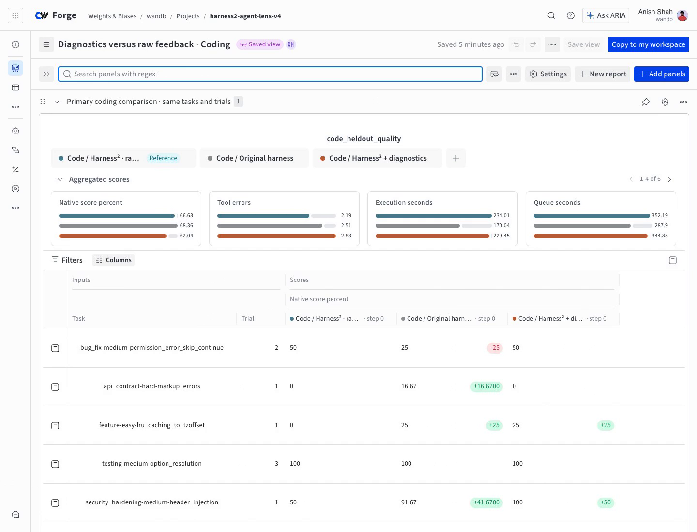

*W&B EvalTables shows the held-out coding comparison: aggregate score cards above aligned task-and-trial rows, with links to the execution evidence.*

This comparison includes all three conditions and uses **raw-feedback Harness² as its reference**; the live panel above uses the original harness. The article’s paired analysis—not these aggregate cards—provides the uncertainty interval.

## What we can learn from the result

Ordinary Harness² completed **19 of its 24 adaptations with executable changes**, and we verified that each held-out execution used the harness frozen for its condition and trial. Where an adaptation had adopted changes, those files were present in the fresh-task execution; unsuccessful adaptations kept their last valid version or baseline.

The average does not tell us which changes helped or hurt on individual tasks. One issue we investigated was whether the harness carried instructions about the old repository into a new one. Part two shows failed reads of old paths, including an execution where the solver recovered, inspected the new repository and built the requested cache. Those traces show the detours, but not how many score points they cost. To measure that effect, we would need to compare harnesses that retain repository-specific instructions with harnesses that require the solver to check those facts again.

This is also a different test from the paper’s reported results. We used GLM-5.3-Flash as both editor and executor, ran two refinement rounds, and tested the frozen harness on different repositories. The published examples above use a different editor and adapt on the task being scored. Our result therefore does not reproduce or overturn those gains.

There is another part of RSI we have not measured here: whether the editor gets better at choosing changes as its experience library grows. We repeated adaptations independently to avoid basing the result on one fortunate checker. Testing accumulated experience would need a longer sequence of tasks with that library carried forward.

## What this tells us about harness-level RSI

Harness² produced harness changes that later solvers used, but our fresh-task evaluation did not establish an average improvement over the original harness. [Part two](https://wandb.ai/wandb/harness2-agent-lens-v4/reports/Testing-structured-diagnostics-in-Harness%C2%B2--VmlldzoxODE4NDczNA==) asks whether structured summaries of execution feedback helped the editor choose better changes.

## Explore the evidence

> **All dashboards & supporting evidence**
>
> [API-contract adaptation probes](https://wandb.ai/wandb/harness2-agent-lens-v4?nw=snk3aigmwn9) — Original harness vs. both compositions; ungraded adaptation
>
> [Coding · frozen harness comparison](https://wandb.ai/wandb/harness2-agent-lens-v4?nw=4o9wknfo8yi) — Fresh-task outputs and independent grades
>
> [Diagnostics versus raw feedback · Coding](https://wandb.ai/wandb/harness2-agent-lens-v4?nw=2fq765iht8y) — Matched tasks and trials
>
> [Help cache · three independent trials](https://wandb.ai/wandb/harness2-agent-lens-v4?nw=0ox7ylka8yk) — Inspect the selected cache example
>
> [JobBench · original native judgments](https://wandb.ai/wandb/harness2-agent-lens-v4?nw=p8xw8ndw5gy) — 33 of 36 original judgments
>
> [JobBench · grading recovery](https://wandb.ai/wandb/harness2-agent-lens-v4?nw=jsd6epuzyn0) — All 36 judgments after grading recovery
>
> [Branching explorer](https://api.wandb.ai/files/wandb/harness2-agent-lens-v4/study-v4-articles-20261026/timeline.html) — Proposals, probes, compositions and selection
>
> [Paired explorer](https://api.wandb.ai/files/wandb/harness2-agent-lens-v4/study-v4-articles-20261026/paired.html) — Companion interactive study explorer
>
> [Agent Lens](https://forge.coreweave.com/agent-lens/wandb/harness2-agent-lens-v4) — Execution traces and conversations
>
> [Project workspace](https://wandb.ai/wandb/harness2-agent-lens-v4) — Project runs and workspace panels
>
> [Complete study report](https://wandb.ai/wandb/harness2-agent-lens-v4/reports/Harness2-Agent-Lens-study-v4--VmlldzoxODE3MzA0Mw==)  ·  [Part two: structured diagnostics](https://wandb.ai/wandb/harness2-agent-lens-v4/reports/Testing-structured-diagnostics-in-Harness%C2%B2--VmlldzoxODE4NDczNA==)

Follow the [branching explorer](https://api.wandb.ai/files/wandb/harness2-agent-lens-v4/study-v4-articles-20261026/timeline.html), inspect the [selected Agent Lens conversation](https://forge.coreweave.com/agent-lens/wandb/harness2-agent-lens-v4/conversations/311f3279da7d4df889284094cbc46301), or compare outputs in the live EvalTables panels. The [75-second walkthrough](assets/harness2-workflow.mp4) follows composition, execution and selection; it predates final grading.

### Inspect the selected execution in Agent Lens

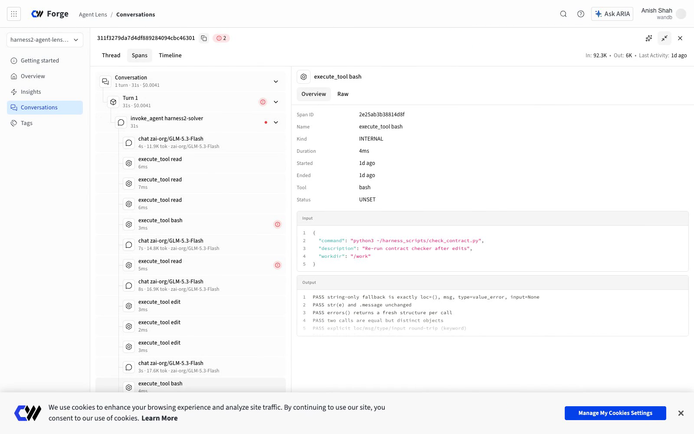

*Agent Lens keeps the selected execution’s tool sequence beside the checker input and output.*

Follow the checker failures, edits, post-edit checks and final diff review in the [selected conversation](https://forge.coreweave.com/agent-lens/wandb/harness2-agent-lens-v4/conversations/311f3279da7d4df889284094cbc46301).

### Saved tables and screenshots

The tables below keep the adaptation records separate from the fresh-task results.

*Native panel: [Weave](https://forge.coreweave.com/wandb/wandb/harness2-agent-lens-v4/reports/Recreating-Harness%C2%B2--VmlldzoxODE5OTAxNQ). Open in the report.*

*Native panel: [Weave](https://forge.coreweave.com/wandb/wandb/harness2-agent-lens-v4/reports/Recreating-Harness%C2%B2--VmlldzoxODE5OTAxNQ). Open in the report.*

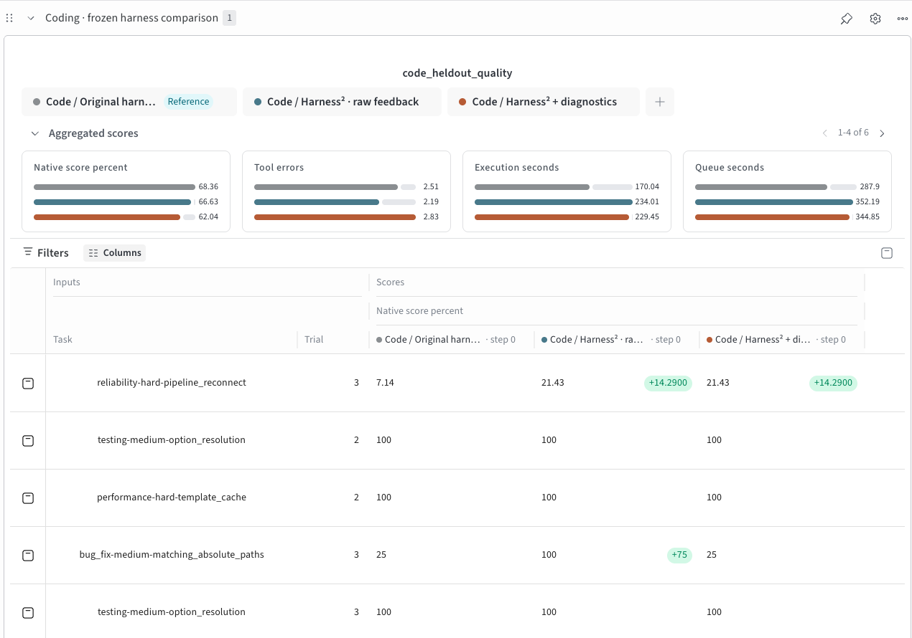

*The saved native EvalTables screen aligns original, raw-feedback and diagnostics outputs on held-out coding tasks.*

## Reproducing the results

The [public fork](https://github.com/ash0ts/harness2-wandb) contains the runner, pinned environment and campaign manifest. The [complete study report](https://wandb.ai/wandb/harness2-agent-lens-v4/reports/Harness2-Agent-Lens-study-v4--VmlldzoxODE3MzA0Mw==) holds the task tables and detailed records.

To reproduce the calculations, download the [analysis bundle](assets/article-analysis.zip) and run `python reproduce_comparisons.py all-252-results.csv`. It includes the original 252 coding and JobBench rows and the unchanged estimator; no model calls or network access are needed. The JobBench grading recovery in part two is separate and does not change this article’s coding result.

[Part two](https://wandb.ai/wandb/harness2-agent-lens-v4/reports/Testing-structured-diagnostics-in-Harness%C2%B2--VmlldzoxODE4NDczNA==) covers diagnostic feedback, JobBench, grading recovery and execution costs.

### Appendix: implementation repairs

Earlier pilots exposed incomplete proposals, offline dependency gaps and collection failures; they remain separate from this study. During this campaign, repairs to provider-stream handling and trace readback resumed saved work. The models, trials and feedback treatment stayed fixed. The [runtime patch bundle](assets/final-runner-patches.zip) preserves the implementation changes.
