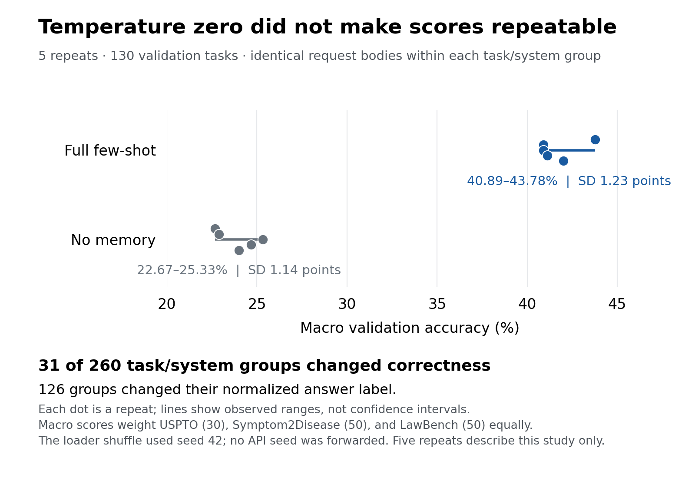
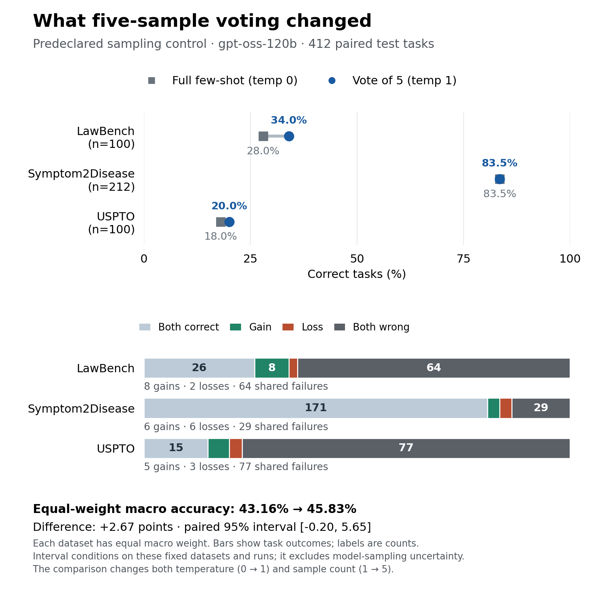

# Before we let an agent optimize the harness

*On these tasks, a larger example context helped much more than five demonstrations. Five-answer voting added a smaller gain at roughly five times the inference cost. We measured both before giving an agent credit for improving its harness.*

In our [Harness² recreation](https://forge.coreweave.com/wandb/wandb/harness2-agent-lens-v4/reports/Recreating-Harness%C2%B2--VmlldzoxODE5OTAxNQ), an agent wrote a checking script, repaired the instructions for finding it, tried another revision and selected the earlier version. We could follow those changes into the next solver execution. On fresh coding tasks, though, we didn't establish an average improvement over the original harness.

That distinction carries into our next experiment. Before giving an agent credit for improving its harness, we need to know what it improved on. A weak starting prompt, a fortunate model response and a larger sampling budget can each make a new version look promising.

While preparing a separate study using Meta-Harness's text-task example, we measured those alternatives. We ran two supplied baselines, repeated unchanged requests, and tested a five-answer voting policy. Then we ran a common-prompt context comparison and a fixed-temperature sampling comparison to separate effects the first pass mixed together. We connected execution and accounting to Forge so we could check the individual attempts behind the scores.

This article covers those completed controls. We haven't completed Meta-Harness's agent-driven search, so there is no optimized harness result here. The model and tasks also differ from our Harness² study; these numbers don't explain or revise its coding results.

## What the editor would have to beat

We used `gpt-oss-120b` through [Forge Inference](https://forge.coreweave.com/inference/models) on three released task sets: predicting reactants from a product in USPTO, matching symptom descriptions to disease labels in Symptom2Disease, and predicting charge labels in LawBench. The test sets contain 100, 212 and 100 tasks respectively.

The simplest baseline sends the problem directly to the model and extracts its final answer. The second places labeled training examples in the prompt and asks the model to follow their patterns. It draws from 50 training examples for USPTO and 200 for each other dataset, with a 30,000-character cap on the examples included in a request. The examples' order is determined from the input, so repeating a task preserves that order. The model's weights don't change.

The third setup uses that same example-based prompt to generate five fresh answers. It groups normalized answer labels, chooses the most common, and breaks a tie by taking the earliest sample in a tied group. We grade the selected original answer. This is a vote over model outputs; it has no access to the correct answer when choosing.

Our initial comparison used the same 412 test tasks for all three setups:

| Setup | Temperature | Answers per task | Mean dataset accuracy | Marginal inference cost |
|---|---:|---:|---:|---:|
| Direct prompt | 0 | 1 | 28.97% | $0.0553 |
| Labeled examples | 0 | 1 | 43.16% | $0.1874 |
| Labeled examples + voting | 1 | 5 | 45.83% | $0.9529–$1.0083 |

*Accuracy gives each dataset equal weight; it isn't the fraction correct after pooling all 412 tasks. Costs use recorded token usage and the prices frozen for this experiment. The voting range includes a conservative allowance for missing usage. These are marginal test-inference estimates, excluding compute, preparation, earlier replayed calls and harness search—not invoices or the total cost of the project.*

The example-based baseline gained **14.19 percentage points** over the direct prompt. A paired task bootstrap gave a 95% interval of **10.24 to 18.23 points**, conditional on these datasets and saved model outputs. Across tasks, 71 answers changed from wrong to correct and 11 went the other way. Both setups failed on 178 tasks.

Every dataset's score rose: USPTO from 13/100 to 18/100, Symptom2Disease from 144/212 to 177/212, and LawBench from 6/100 to 28/100. The gain belongs to these baseline implementations, including their different instructions and example context. We didn't isolate the effect of examples from the surrounding prompt wording.

That made the example-based baseline a comparator to take seriously. Before attributing its whole gain to demonstrations, though, we needed to hold the surrounding instructions fixed.

## We need to know what “correct” means

Before interpreting that gain, we checked the scoring code and regraded the saved predictions. These tasks have deterministic scorers, but they measure particular answer conventions.

The USPTO scorer compares sets of dot-separated reactant strings after lowercasing. Symptom2Disease extracts and normalizes a disease label before matching it. LawBench compares sets of extracted charge labels. These checks don't establish chemical equivalence, clinical validity or legal correctness.

That limits the claim we can make about examples. They may help the model solve a problem, match the expected naming convention, or both. The measured gain is agreement with the frozen scorers. We haven't separated those mechanisms, and changing the scorer after seeing the outputs would answer a different question.

We also found one exact validation–test overlap in Symptom2Disease. Removing it leaves 411 test tasks and changes the examples-versus-direct difference from 14.19 to **14.21 points**. We retain the declared 412-task result and report that sensitivity separately. These are released benchmark examples, with no claim that they were absent from the model's training data.

## A handful of examples wasn’t enough

We followed up with one set of neutral instructions and three context sizes: zero examples, five examples, and a larger pool under the same 30,000-character cap. Each task uses one deterministic shuffle of the training examples; the five-example condition is a prefix of that same ordering. The solver, generation settings and native scorers stayed fixed.

We generated five fresh answers per task and condition at temperature zero. Each task contributes its mean correctness across those five draws, then we average the three dataset scores equally. This measures the single-answer behavior we observed across repeats; no vote is involved in this table.

| Context | USPTO | Symptom2Disease | LawBench | Mean dataset accuracy | Mean inference cost per pass |
|---|---:|---:|---:|---:|---:|
| 0 examples | 13.40% | 68.68% | 10.80% | 30.96% | $0.0527 |
| 5 examples | 13.00% | 67.92% | 19.80% | 33.57% | $0.0669–$0.1072 |
| Larger pool, capped | 15.40% | 80.66% | 27.20% | 41.09% | $0.1930 |

*Each cost is the five-draw test-inference total divided by five: an average pass over all 412 tasks. Scores weight datasets equally; costs sum their actual requests, and the five-example range retains missing usage from interrupted attempts.*

Five examples added **2.62 points**, with a conditional 95% task-bootstrap interval of **0.64 to 4.66**. The improvement came from LawBench; USPTO and Symptom2Disease declined slightly with five examples in this run.

The larger context added **10.13 points** over zero examples, with an interval of **7.39 to 13.01**. It also beat five examples by **7.51 points**, with an interval of **4.99 to 10.14**. Holding the instructions fixed preserved a substantial example-context effect, although it was smaller than the original implementations’ 14.19-point difference. Those are separate comparisons with separate model draws.

The cap mattered. The larger condition actually supplied 50 USPTO examples, 172–178 Symptom2Disease examples, and 31–75 LawBench examples per request. Calling all of these “200-shot” would misdescribe what the model saw.

I’d test a small and a larger example budget before treating a few-shot prompt as a strong baseline. On this suite, stopping at five demonstrations would miss most of the measured gain. The larger context cost about 3.66 times the zero-example pass; that is a tradeoff to measure, not a free improvement.

We froze these comparisons before running them, but the 412 released test tasks had already been inspected in the earlier controls. This is a prospective follow-up on that task set, not an untouched final evaluation.

## Repeating the same request changed the result

A search process chooses between candidate harnesses based on measured scores. If a score can move without a harness edit, a small apparent improvement needs another explanation before it gets credited to the editor.

We ran each baseline five times on 130 validation tasks: 30 USPTO, 50 Symptom2Disease and 50 LawBench. That creates 260 task-and-baseline groups and 1,300 scored outputs. Every group had identical serialized requests across its five repeats, including temperature zero. We did not supply a model API seed; the dataset loader's seed controls task ordering, not provider execution.

Correctness changed across repeats in **31 of the 260 groups**. The normalized answer label changed in 126 groups. Those are different measurements: a model can produce several different wrong answers without changing its score.

*The dots are five observed repeats, not five new task sets. The range describes this run; it is not a confidence interval. Validation scores use a different task set from the test results above.*

The example-based validation mean ranged from 40.89% to 43.78%; the direct-prompt mean ranged from 22.67% to 25.33%. We haven't identified the provider-level cause of that variation. We have established that, in this setup, setting temperature to zero did not make repeated outputs or scores identical.

The task-bootstrap intervals in this article hold the saved model outputs fixed. They do not include this additional variation from rerunning the model, or the uncertainty introduced by searching over many harness candidates. Five repeats describe a baseline we can observe; they aren't a universal noise threshold for accepting edits.

## The first voting comparison changed two things

The voting policy reached 45.83%, **2.67 points** above the single example-based answer. Its paired 95% interval was **−0.20 to +5.65 points**. We haven't established a gain under this comparison, and an interval crossing zero doesn't establish equivalence either.

Voting fixed 19 tasks that the single-answer baseline missed and broke 11 it had answered correctly. On Symptom2Disease, both scored 177/212, but they didn't succeed on exactly the same tasks: voting gained six and lost six.

*Each comparison follows the same task across the two policies. Both policies were wrong on 170 tasks. The aggregate difference hides the changes that cancel out, especially on Symptom2Disease.*

This comparison changes both the number of samples and temperature. As a secondary analysis of the saved five-sample runs, we also compared the vote with the first temperature-one sample. The advantage shrank to **1.33 points**, with an interval of **−1.02 to +3.82**. That first sample was fixed by its position, not selected for its score; it is still part of the same five draws.

The voting run used **5.08–5.38 times** the marginal inference cost of the single example-based answer. Fourteen provider attempts ended without complete usage, so we preserve their possible cost in the upper bound. Retrying them doesn't make the failed attempts free. The campaigns also overlapped and encountered throttling, so we don't use their wall times to claim a latency advantage.

That first comparison left the sampling decision unresolved. We needed to compare different answer budgets while holding temperature fixed.

## What three and five answers buy at fixed temperature

For the larger-context prompt in the follow-up, we compared the first one, three and five answers at temperature zero. We also ran the same comparison at temperature one as supporting evidence. Sample positions were fixed in advance. We never picked the highest-scoring draw as the single-answer baseline, and the plurality rule never saw the correct label.

| Answers per task | Temperature 0 accuracy | Temperature 0 cost | Temperature 1 accuracy | Temperature 1 cost |
|---|---:|---:|---:|---:|
| 1 answer | 40.92% | $0.1940 | 40.06% | $0.1932 |
| 3 answers | 42.40% | $0.5789 | 41.22% | $0.5831 |
| 5 answers | 43.53% | $0.9649 | 43.04% | $0.9732 |

*All five draws were executed and paid for. The one- and three-answer costs are attributed to those prefixes of the saved run, not bills from separately deployed policies. This table starts with the first draw alone; the context table averages all five individual scores, so their single-answer summaries need not match.*

At temperature zero, three answers gained **1.47 points** over the first answer, with a 95% interval of **−0.33 to 3.43**. Five answers gained **2.61 points**, with an interval of **0.61 to 4.79**. The supporting temperature-one comparison also favored five answers: **2.98 points**, with an interval of **0.82 to 5.30**.

The matched experiment supports a gain that the first comparison couldn't establish: on these saved tasks and draws, five-answer voting improved on the fixed first-answer baseline at the same temperature. It cost about five times as much inference. I’d keep both policies as comparators, and make the extra accuracy justify its cost for the application. An editor that also spends five calls per task should have to beat the five-call control.

Removing the known validation–test overlap leaves the larger-context gain at **10.15 points** and the temperature-zero five-answer gain at **2.61 points**.

## Sometimes the correct answer was already there

In the earlier five-answer, temperature-one experiment, we kept all five outputs for every task, including the four that the vote didn't select. That cohort lets us distinguish two problems a final accuracy number combines; the counts below belong to that earlier run.

On **156 of 412 tasks**, all five answers were wrong under the native scorer. A selector restricted to those answers had no correct answer available. On another **25 tasks**, at least one sample was correct but the vote selected a wrong answer.

| Dataset | All five answers wrong | Correct answer available, vote missed it |
|---|---:|---:|
| USPTO · 100 tasks | 76 | 4 |
| Symptom2Disease · 212 tasks | 20 | 15 |
| LawBench · 100 tasks | 60 | 6 |

There were also **33 tasks where all five samples agreed on the same normalized label and that answer was wrong**. Agreement alone did not settle correctness.

These counts suggest different experiments. When every candidate is wrong, changing only the selector cannot recover a correct answer from that set. When a correct candidate exists, we can compare selectors on the same saved candidates and give them equal budgets. The 25 missed answers identify an opportunity to investigate selection; they don't show that an implementable selector can recognize those answers without looking at the labels.

This connects to the question left by our Harness² walkthrough, where the editor preferred an earlier patch partly because of a visible hint about change size. Proposing candidates and recognizing the strongest candidate need separate tests. Our voting experiment measures that distinction in a simpler setting; it doesn't validate a selector for coding patches.

## What Forge let us check

The original controls ran in [CoreWeave Sandboxes](https://docs.coreweave.com/products/sandboxes), with Forge Inference for solver calls, [Agent Lens](https://docs.coreweave.com/products/agent-lens) for stored execution traces, and W&B runs, Tables and artifacts for results. For the added context and sampling study, Sandbox access began returning permission errors before measured tests, so we ran every new arm through the same reviewed local workers with worker network access restricted to loopback (host execution rather than cloud sandbox isolation), keeping inference and telemetry on CoreWeave Forge.

The worker returned an answer and its task identity; our runner joined it to the provider attempt, applied the frozen scorer, and preserved that link through export. In the follow-up, one batch failed after 97 of its 100 calls completed, so recovery reused those 97 saved responses and requested only the missing three while keeping the original calls in the cost ledger. Preparation had also exposed our own two-megabyte streaming-response cap on a valid HTTP 200 stream; we retained that partial attempt, raised the transport allowance before testing, and started the measured follow-up fresh without changing the model's output-token budget.

The completed follow-up retained **65 interrupted provider attempts with missing usage**, bringing its usage-priced inference estimate to **$2.7150–$2.9166** across preparation and all five draws in all four arms (`8,240` test outcomes across `1,648` task-and-condition groups). In Agent Lens, failed calls without returned usage displayed zero tokens; checking their failure metadata and absent raw usage fields kept those attempts bounded in our ledger rather than treating a zero in a trace view as a free call. When we initially passed an unreleased evaluation-service backend flag during the November 10 run, table creation returned HTTP 500 and we recorded a fallback to W&B Tables; exporting those same **1,648 rows across all four arms** through the shipped Weave-backed [Forge EvalTables](https://forge.coreweave.com/wandb/wandb/mh-forge-preflight-20261110) (`wandb.EvalTable`) now aligns direct zero-shot, retrieved few-shot, single-draw, and five-draw voting side by side in the shared Forge project with zero additional model calls. Detailed traces remain access controlled; the public calculation bundle contains scores and numeric usage without task text or answer labels.

## The next harness experiment

For the next search, I’d use the larger example context under common instructions as the primary baseline, and retain both one-answer and five-answer policies with their costs. Five demonstrations did not capture the larger context’s benefit. Five-answer voting did earn a modest gain in the matched follow-up, so an expensive candidate should face that comparator too. Small validation gains still need repeated measurements, and a selector needs evaluation separate from its candidate generator.

We have now inspected these released test outcomes, so I would not use them as an untouched final evaluation while tuning the next method. I'd develop the candidate and selector policies on development data, freeze them, and evaluate on a fresh reserved set with repeated runs. The retained attempt records would let us distinguish a changed procedure from a rerun that happened to go better.

## Inspect the calculations

The [analysis download](assets/analysis.zip) contains the earlier paired scores and validation repeats, the new 8,240 test outcomes, numeric records for all 8,826 provider attempts in the completed follow-up, and standard-library reproduction scripts. It recomputes the headline means, paired intervals and per-attempt usage prices without model calls. Ordinal answer classes let readers rebuild the votes without seeing answer labels. The download cannot independently regrade withheld answer text; it contains no task prompts, target labels, private traces or raw model responses.

The setup follows the pinned [Meta-Harness text-task example](https://github.com/stanford-iris-lab/meta-harness/tree/f805ad3aa4ada290458c1e0deadbe132fbbdea4e/reference_examples/text_classification). Our scorer and data snapshots stayed fixed across these controls. The comparison is specific to this solver, provider, task selection and prompt implementations; testing a new editor or a new model requires another experiment.
